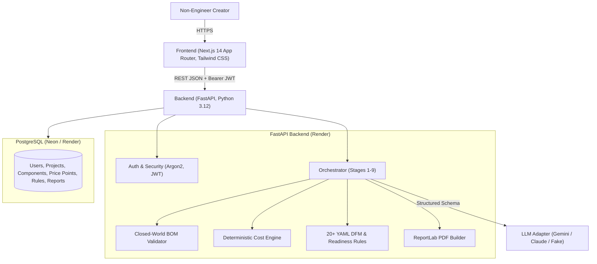

# Idea2market

> **AI-Assisted Idea-to-Prototype Planning for Hardware Non-Engineers**  
> *Open Innovation Track &bull; 13th Protocol: An AI Hackathon 2026*  
> *Built by: Yashashvi, Yati, Vaishnavi, and team*

---

## ⚠️ Non-Negotiable Product Disclaimer

> **AI-generated preliminary draft. Not an engineering certification, not a quotation, and not a safety or regulatory approval. Have a qualified engineer review before building or selling anything.**

Idea2market is a **planning assistant**, not an engineering certifier. It operates strictly in the **pre-CAD space**, helping creators turn plain-language ideas into structured, reviewable technical specifications, preliminary architectures, catalogued Bills of Materials (BOM), budget ranges, and readiness checklists before spending money on CAD or prototypes.

---

## Core Safeguards Enforced in Code

1. **Closed-World BOM**: The BOM strictly allows components existing in the curated database (~120 vetted agricultural rover components). Any hallucinated component ID proposed by an LLM is dropped and logged.
2. **Deterministic Arithmetic**: The LLM **never** performs math. Price totals, low/high ranges, and allowances (fabrication, shipping, rework contingency) are computed strictly in Python code.
3. **Ranges, Not Point Estimates**: Costs are presented as `[low, high]` ranges in INR. Seed prices are explicitly marked as **unverified placeholder estimates** (`price_verified = false`).
4. **Safety-Critical Domain Gating**: Concepts involving medical devices, road vehicles, AC mains voltages (>50V), pressure vessels, explosives, or children's toys automatically trigger prominent hazard warnings and force the readiness status to `"not assessed: requires qualified engineer"`.
5. **No Hallucinated Claims**: No fake partnerships, supplier endorsements, or certification guarantees.

---

## System Architecture



---

## Monorepo Layout

```
idea2market/
├── README.md
├── CONTRIBUTING.md
├── docker-compose.yml           # Local PostgreSQL
├── render.yaml                  # Render Blueprint (backend)
├── .github/workflows/ci.yml     # Automated CI pipeline
├── docs/
│   ├── ARCHITECTURE.md          # Technical design & data flow
│   ├── DEPLOYMENT.md            # Step-by-step production runbook
│   ├── API.md                   # REST API documentation
│   ├── EVALUATION.md            # Benchmark methodology
│   └── DEMO_SCRIPT.md           # 4-minute hackathon walkthrough
├── backend/
│   ├── requirements.txt         # Pinned production dependencies
│   ├── requirements-dev.txt     # Test and dev tooling
│   ├── alembic.ini              # Database migration configuration
│   ├── app/
│   │   ├── main.py              # FastAPI application entrypoint
│   │   ├── config.py            # Pydantic-settings environment config
│   │   ├── db.py                # SQLAlchemy engine & session
│   │   ├── models/              # SQLAlchemy database tables
│   │   ├── schemas/             # Pydantic validation schemas
│   │   ├── api/                 # REST routers (auth, projects, jobs, etc.)
│   │   ├── core/                # Security (Argon2, JWT), rate limits
│   │   ├── llm/                 # Provider-agnostic LLM client & fake client
│   │   ├── pipeline/            # 9-stage planning pipeline orchestrator
│   │   ├── prompts/             # Versioned prompt files
│   │   ├── rules/               # YAML DFM, readiness, and safety rules
│   │   ├── services/            # Cost engine, BOM validator, PDF builder
│   │   └── seed/                # ~120 components & facilities seed data
│   └── tests/                   # Pytest test suite
├── eval/
│   ├── gold_set.jsonl           # 15 test ideas (agri-rover, IoT, safety)
│   ├── run_eval.py              # Automated scoring script
│   └── results.md               # Benchmark evaluation report
├── frontend/
│   ├── package.json             # Next.js 14, React 18, Tailwind CSS
│   ├── netlify.toml             # Netlify deployment configuration
│   └── src/                     # App Router pages and components
└── scripts/
    ├── smoke_test.py            # End-to-end smoke test script
    └── dev.sh                   # Local startup helper
```

---

## Local Development Setup

### 1. Prerequisites
- Python 3.9+ (Python 3.12 recommended)
- Node.js 18+ & npm
- Docker (optional, for local PostgreSQL)

### 2. Start PostgreSQL
```bash
docker compose up -d postgres
```

### 3. Backend Setup
```bash
cd backend
python3 -m venv .venv
source .venv/bin/activate
pip install -r requirements-dev.txt

# Configure environment
cp .env.example .env

# Run migrations and seed data
alembic upgrade head
python -m app.seed.seed

# Run unit tests
pytest tests -v

# Start backend server (port 8000)
uvicorn app.main:app --reload --port 8000
```

### 4. Frontend Setup
```bash
cd frontend
npm install
cp .env.example .env.local

# Run frontend dev server (port 3000)
npm run dev
```

Visit `http://localhost:3000` in your browser.

---

## Production Deployment

- **Backend**: Deployed on **Render** via Blueprint (`render.yaml`).
- **Frontend**: Deployed on **Netlify** via `frontend/netlify.toml`.
- **Database**: **Neon Free Postgres** (persistent, connection-pooled) or Render Postgres.

Detailed instructions are available in [`docs/DEPLOYMENT.md`](docs/DEPLOYMENT.md).

---

## Evaluation Benchmark

Run the automated evaluation benchmark:
```bash
python eval/run_eval.py
```

| Metric | Target | Result |
|---|---|---|
| **Closed-World BOM Resolvability** | 100% | **100.0%** |
| **Safety Domain Gating Accuracy** | 100% | **100.0%** |
| **Schema Validity Rate** | 100% | **100.0%** |
| **Deterministic Arithmetic Integrity** | 100% | **100.0%** |

---

## Out of Scope (By Design)

The following capabilities are deliberately excluded from this scope:
- Crowdfunding campaigns and pre-order payment collection (solved by Kickstarter/Indiegogo).
- Manufacturer and investor matching marketplaces (requires high two-sided liquidity).
- CAD geometry analysis and text-to-CAD (requires professional CAD workflows).
- Formal regulatory certifications or liability guarantees.
>>>>>>> b5b4fad (feat: initial implementation of Idea2market AI product engineer platform)
