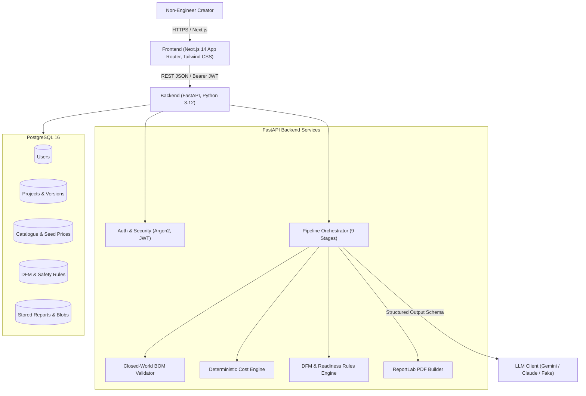

# Idea2market: System Architecture

Idea2market is an AI-assisted planning tool designed for non-engineers to translate hardware concepts into structured, reviewable engineering drafts before CAD or physical prototyping.

---

## 1. High-Level Architecture Overview

---

## 2. Nine-Stage AI Pipeline & Guardrails

| Stage | Name | Input | Output | Invariant & Guardrail |
|---|---|---|---|---|
| **1** | **Clarify** | Free-text idea | Up to 5 clarifying questions | Max 5 questions; Pydantic schema validation |
| **2** | **Requirements** | Idea + creator answers | Structured requirements | Functional, constraint, and explicit assumptions |
| **3** | **Architecture** | Requirements | Subsystems & interfaces | Every subsystem maps to a requirement |
| **4** | **Retrieve** | Subsystems | Candidate catalogue rows | SQL-only search over vetted catalogue rows |
| **5** | **BOM Assembly** | Candidate components | Proposed BOM items | **Closed-world**: unknown IDs are dropped |
| **6** | **Cost Engine** | Validated BOM | INR budget ranges | **Deterministic Python code**: no LLM arithmetic |
| **7** | **Rules Engine** | Requirements + BOM | DFM & readiness checks | 20+ declarative rules in YAML |
| **8** | **Roadmap & Risks**| All stages | Milestones & risk matrix | Mandatory technical reason for each failure mode |
| **9** | **Report Builder**| Merged JSON | Structured JSON + PDF | Disclaimer watermark present on every page |

---

## 3. Product Safeguards

1. **Closed-World BOM**: The BOM strictly allows components existing in the curated database. Any hallucinated ID is rejected.
2. **Deterministic Arithmetic**: Low and high price ranges, allowances (fabrication, shipping, consumables, rework) are computed with Python float arithmetic.
3. **Safety Domain Gating**: Medical, high-voltage mains, automotive, pressure vessels, and hazardous chemical ideas force readiness status to `"not assessed: requires qualified engineer"` with an advisory banner.
4. **Unverified Seed Prices**: Seed prices are flagged with `price_verified = false` and rendered with a badge in UI and PDF.
